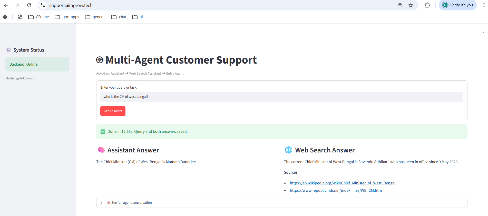

# 🤖 Multi-Agent Customer Support (AutoGen + FastAPI + Streamlit)

**🌐 Live demo:** https://support.aimgrow.tech

A production-style customer support system where **three AutoGen agents** work in sequence:

1. **Assistant**: answers from its own knowledge (no tools)
2. **Web Search Assistant**: searches the web (Serper) and answers from live results
3. **Entry Agent**: saves the query + both answers to `data/answers.txt` and returns both answers

Built for the **Gen AI Architect Program – Weekly Buildathon**, first as a single `app.py`, then restructured into a SaaS-ready layout and deployed with Docker, Nginx and HTTPS.



> 💡 **Why two answers?** The Assistant relies on the model's training data, which can be outdated.
> The Web Search Assistant grounds its answer in live search results. Asking
> *"Who is the CM of Tamil Nadu now?"* shows the difference clearly.

---

## ✅ Buildathon Requirements

| Requirement | Where |
|---|---|
| AutoGen AgentChat with a sequential team (`RoundRobinGroupChat`) | `backend/agents/support_team.py` |
| Three `AssistantAgent`s, each with its own `system_message` | `backend/agents/support_team.py` |
| Web-search tool **only** on Web Search Assistant | `backend/tools/web_search.py` |
| Save-to-file tool **only** on Entry Agent | `backend/tools/file_store.py` |
| Termination condition (`TextMentionTermination` + `MaxMessageTermination`) | `backend/agents/support_team.py` |
| Streamlit UI with query input, both answers shown | `frontend/app.py` |
| Query + both answers saved to a `.txt` file | `data/answers.txt` |
| API keys from environment variables, never committed | `.env` (see `.env.example`) |

---

## 🏗️ Architecture

```
User ─HTTPS─▶ Nginx (SSL) ─▶ Streamlit (frontend)
                                │  HTTP POST /api/v1/support
                                ▼
                            FastAPI (backend)
                                │
                                ├─▶ Guardrails (input check) ── blocked? ─▶ return early (no LLM cost)
                                │
                                ├─▶ AutoGen RoundRobinGroupChat (fresh team per request)
                                │      Assistant ─▶ Web_Search_Assistant ─▶ Entry_Agent
                                │                        │                      │
                                │                   web_search (Serper)    save_to_file
                                │
                                └─▶ Guardrails (output redaction) ─▶ JSON response
```

## ✨ Features

- **Sequential multi-agent team** with termination conditions
- **Fresh team per request**: no shared conversation history between users
- **Date-aware web agent** that trusts live search results over stale model knowledge
- **Guardrails**: prompt-injection / jailbreak blocking, length limits, API-key redaction
- **FastAPI backend** with Swagger docs (`/docs`) and health check (`/health`)
- **Streamlit frontend** that talks only to the API (no keys in the frontend)
- **Structured logging** with rotating log files
- **Tests**: fast unit tests (pytest) + LLM quality evals (DeepEval)
- **Docker Compose** with health checks, volumes and restart policies
- **Deployed** on a VPS behind Nginx with Let's Encrypt HTTPS

## 📁 Project Structure

```
├── backend/
│   ├── main.py                 # FastAPI app
│   ├── config.py               # Settings from .env (pydantic-settings)
│   ├── agents/support_team.py  # 3 agents + team factory
│   ├── tools/                  # web_search.py, file_store.py
│   ├── services/               # support_service.py, guardrails.py
│   ├── routes/                 # health.py, support.py
│   └── utils/logger.py
├── frontend/
│   ├── app.py                  # Streamlit UI
│   └── requirements.txt
├── tests/
│   ├── test_guardrails.py      # free, fast unit tests
│   ├── test_eval_deepeval.py   # paid LLM evals (marker: eval)
│   └── smoke_*.py              # manual smoke tests
├── docker/
│   ├── Dockerfile.backend
│   └── Dockerfile.frontend
├── docs/demo.png
├── docker-compose.yml
├── requirements.txt            # production dependencies
├── requirements-dev.txt        # + pytest, deepeval
├── pytest.ini
└── .env.example
```

## ⚙️ Configuration

Copy `.env.example` to `.env` and fill in your keys:

```
OPENAI_API_KEY=your-openai-key-here
SERPER_API_KEY=your-serper-key-here
LLM_MODEL=gpt-4.1-mini
DATA_DIR=./data
LOG_DIR=./logs
BACKEND_URL=http://localhost:8000
```

> 🔒 Never commit `.env`. It is listed in `.gitignore` and `.dockerignore`.

## 🐳 Run with Docker (recommended)

```bash
docker compose up --build -d
docker compose ps          # both services should be (healthy)
```

| Service  | URL                            |
|----------|--------------------------------|
| Frontend | http://localhost:8502          |
| Backend  | http://localhost:8001/health   |
| API docs | http://localhost:8001/docs     |

Host ports `8001` / `8502` map to container ports `8000` / `8501`, so this app can run next to other apps on the same machine.
Stop with `docker compose down`. Answers and logs persist in `./data` and `./logs`.

## 🐍 Run locally (without Docker)

```bash
python -m venv venv
venv\Scripts\activate          # Windows  (Linux/Mac: source venv/bin/activate)
pip install -r requirements-dev.txt

python -m backend.main                  # terminal 1 → http://localhost:8000
streamlit run frontend/app.py           # terminal 2 → http://localhost:8501
```

## 🛡️ Guardrails

| Layer | What it does |
|---|---|
| **Input** | Blocks empty / too-short / too-long (> 500 chars) queries and common prompt-injection, jailbreak and secret-extraction patterns **before** any LLM call |
| **Output** | Redacts real API key values and OpenAI-style keys from every answer and trace |

Blocked queries return `"blocked": true` with a reason and cost nothing.

## 🧪 Tests & Evaluation

```bash
python -m pytest -v            # 11 guardrail unit tests (free, < 1 s)
python -m pytest -m eval -v    # 5 DeepEval quality tests (uses OpenAI credits)
```

**DeepEval setup:** 5 real-world questions, two metrics, threshold 0.7, judge model `gpt-4.1`:

- **Relevancy** (custom `GEval`): does the web answer directly address the question?
- **Faithfulness**: is every claim supported by the live search context?

**Current result:** ✅ 5 / 5 passed

**Lessons learned while building the evals:**
- The judge LLM has a knowledge cutoff too. For fresh facts it marked correct answers as "wrong"
  until it was given the **search context and today's date** as evidence.
- The judge should be **stronger** than the model being tested.
- Only **infrastructure errors** (timeouts, 5xx) are retried; quality failures are never retried.

## 🔌 API

`POST /api/v1/support`

```json
{ "query": "How do I reset my password?" }
```

Returns `assistant_answer`, `web_answer`, `blocked`, `block_reason`, `duration_seconds` and a full agent `trace`.

## 🚀 Deployment (VPS + Nginx + HTTPS)

```bash
# On the server
cd /opt/apps
git clone https://github.com/YOUR-USERNAME/buildathon-support-autogen.git
cd buildathon-support-autogen
nano .env && chmod 600 .env
docker compose up --build -d
```

- Containers bind to `127.0.0.1` only, so the app is reachable **only through Nginx**
- Nginx reverse-proxies `support.aimgrow.tech` → `127.0.0.1:8502` (with WebSocket headers for Streamlit)
- HTTPS certificate from Let's Encrypt via `certbot --nginx`, auto-renewed
- The backend API is not exposed publicly; the frontend reaches it over the Docker network

## 🗺️ Roadmap

- [ ] User authentication and per-user rate limiting
- [ ] Database for conversation history (instead of a text file)
- [ ] Streaming agent responses to the UI
- [ ] CI pipeline (GitHub Actions) running tests on every push
- [ ] LLM-based moderation on top of regex guardrails

## 🛠️ Tech Stack

Python 3.11 · AutoGen AgentChat 0.7 · OpenAI `gpt-4.1-mini` · Serper · FastAPI · Streamlit · pytest · DeepEval · Docker · Nginx · Let's Encrypt

## 👤 Author

**Abdullah**, Gen AI Architect Program